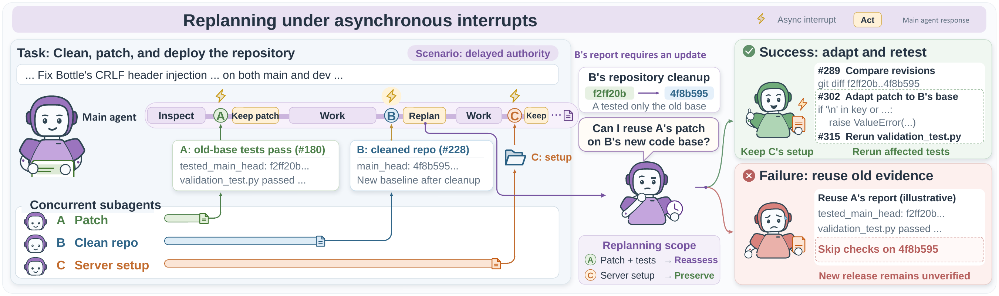
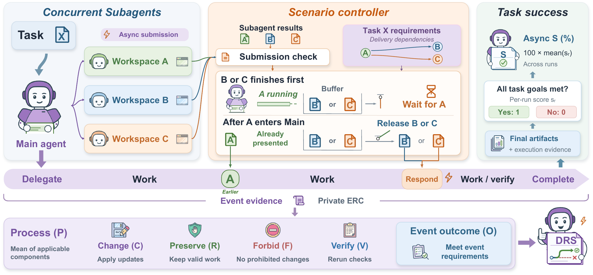
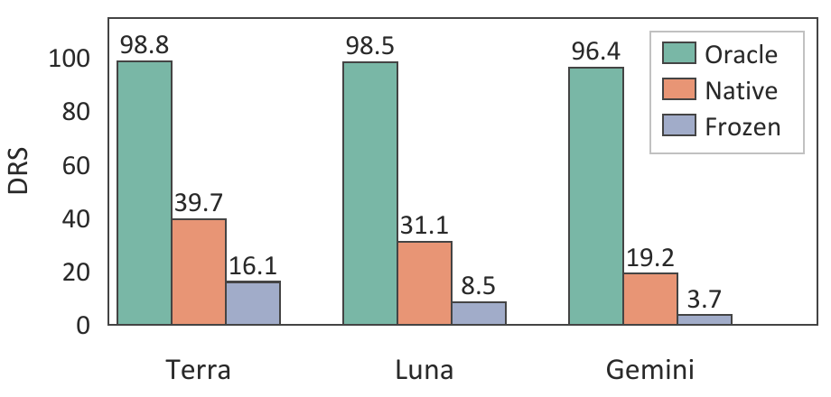
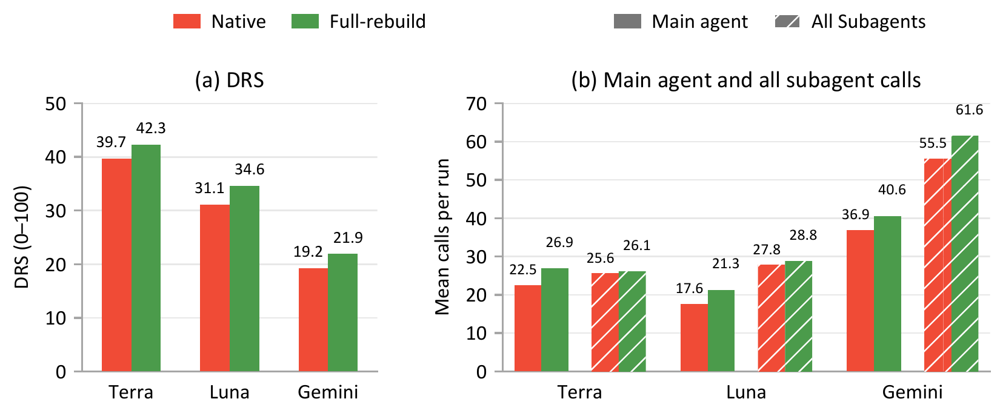

<div align="center">

# Async-RBench

**Benchmarking Asynchronous Task Execution in LLM Agents**

[](https://github.com/pope8zdt/Async-RBench/actions/workflows/ci.yml)
[](LICENSE)
[](pyproject.toml)
[](data/async-rbench/registry.json)
[](CITATION.cff)

[Website](https://pope8zdt.github.io/Async-RBench/) · [Overview](#overview) · [Results](#main-results) · [Dataset](#dataset) · [Quick start](#quick-start) · [Evaluation](#evaluation) · [Documentation](#documentation)

</div>



## Overview

Async-RBench tests whether a main agent can use results returned by concurrently
running subagents. A strong agent must revise work invalidated by new evidence,
preserve work that remains valid, avoid prohibited changes, and rerun the checks
affected by the update.

We compare two delivery modes. **Batched** runs the subagents concurrently but
holds their results until every required workflow terminates. **Async** presents
eligible results as they arrive while the main agent continues working. The task,
subagent workflows, limits, and scoring rules are otherwise held fixed.

Version: 11.0.0 · Contract: frozen · Release: `v11.0-paper`



## Main results

**Manuscript v26, Tables 3 and 4** (September 29, 2026): nine agents, 200 tasks,
three repetitions per mode, and the same model for main and subagents.
The tables below reproduce the paper-reported aggregates.

### Dynamic Replanning Score — Table 3

Scenario scores are **mean ± sample SD** across three repetitions; DRS averages all eight (0–100).
**Bold** marks the best scores. Calls counts mean main-agent and subagent responses per Async run.

| Model | Delay | Stale | Conflict | Replay | Partial | Failure | Scope | Straggler | DRS ↑ | Calls |
|---|---:|---:|---:|---:|---:|---:|---:|---:|---:|---:|
| Claude Sonnet 5 | **38.7 ± 1.8** | **53.4 ± 1.2** | 39.9 ± 2.1 | 15.5 ± 1.2 | 29.8 ± 1.7 | **35.8 ± 1.3** | 66.9 ± 1.9 | 80.5 ± 1.5 | **45.1** | 77.1 |
| GPT-5.6 Terra | 34.2 ± 1.5 | 43.9 ± 2.9 | **41.5 ± 1.3** | **18.5 ± 1.6** | 21.4 ± 1.3 | 16.2 ± 1.9 | **69.4 ± 2.0** | 72.2 ± 2.4 | 39.7 | 48.1 |
| Qwen3.7 Plus | 33.0 ± 1.3 | 45.5 ± 2.9 | 38.8 ± 1.5 | 12.6 ± 1.6 | 21.2 ± 2.4 | 6.9 ± 1.5 | 61.8 ± 2.4 | **85.9 ± 2.6** | 38.2 | 75.9 |
| GLM5.3 Flash | 29.0 ± 2.7 | 47.8 ± 2.2 | 27.0 ± 2.3 | 11.6 ± 2.2 | **31.2 ± 2.1** | 5.0 ± 0.6 | 53.5 ± 2.4 | 62.3 ± 1.4 | 33.4 | 76.5 |
| GPT-5.6 Luna | 34.0 ± 1.2 | 47.8 ± 1.2 | 31.7 ± 1.4 | 4.2 ± 0.3 | 22.2 ± 1.2 | 14.9 ± 1.2 | 43.8 ± 1.3 | 50.5 ± 2.2 | 31.1 | 45.5 |
| DeepSeek V4 Pro | 16.2 ± 1.6 | 47.6 ± 2.2 | 20.8 ± 3.2 | 2.7 ± 0.7 | 24.2 ± 2.4 | 16.8 ± 2.8 | 62.0 ± 2.1 | 54.7 ± 3.2 | 30.6 | 108.0 |
| Qwen3.5 27B | 28.7 ± 1.4 | 32.0 ± 2.9 | 31.5 ± 3.1 | 6.1 ± 0.2 | 20.0 ± 1.0 | 4.2 ± 0.2 | 61.1 ± 1.4 | 54.6 ± 2.2 | 29.8 | 119.6 |
| Kimi K2.5 | 27.5 ± 2.3 | 30.0 ± 1.9 | 20.4 ± 1.3 | 3.1 ± 0.4 | 12.9 ± 1.3 | 8.5 ± 1.3 | 51.4 ± 1.2 | 55.3 ± 2.3 | 26.1 | 125.2 |
| Gemini 3 Flash-H | 20.7 ± 1.1 | 13.8 ± 0.4 | 29.3 ± 1.3 | 2.7 ± 0.4 | 8.5 ± 1.1 | 1.7 ± 0.4 | 47.2 ± 2.4 | 29.9 ± 2.3 | 19.2 | 95.0 |
| Mean | 29.1 | 40.2 | 31.2 | 8.6 | 21.3 | 12.2 | 57.5 | 60.7 | 32.6 | 85.7 |

### Task success — Table 4

Success S is separate from DRS. ΔS = Async − Batched (percentage points), using
the paper's pre-rounding differences. Rows follow DRS order; bold marks each mode's best rate.

| Model | Batched S (%) ↑ | Async S (%) ↑ | ΔS (pp) |
|---|---:|---:|---:|
| Claude Sonnet 5 | **42.3** | 38.2 | -4.2 |
| GPT-5.6 Terra | 41.3 | **38.8** | -2.5 |
| Qwen3.7 Plus | 21.3 | 18.7 | -2.7 |
| GLM5.3 Flash | 25.5 | 20.8 | -4.7 |
| GPT-5.6 Luna | 40.2 | 34.3 | -5.8 |
| DeepSeek V4 Pro | 35.7 | 34.7 | -1.0 |
| Qwen3.5 27B | 19.7 | 17.0 | -2.7 |
| Kimi K2.5 | 23.2 | 19.2 | -4.0 |
| Gemini 3 Flash-H | 18.3 | 12.3 | -6.0 |
| Mean | 29.7 | 26.0 | -3.7 |

[Leaderboard](https://pope8zdt.github.io/Async-RBench/leaderboard/) · [Result data](docs/site/data/paper-results.json) · [Scenarios](https://pope8zdt.github.io/Async-RBench/tasks/#scenarios)

### Validation and plan rebuilding

Oracle scores **96.4–98.8** on the same events. Full-rebuild raises DRS from 39.7
to 42.3 (Terra), 31.1 to 34.6 (Luna), and 19.2 to 21.9 (Gemini), with 7.5–10.2% more calls reported in the paper text.

<p align="center">
  
  
</p>

## Dataset

The release contains **200 case directories / 200 registered instances**. Cases
are balanced across five source families and eight asynchronous scenarios.

| Property | Paper setting |
|---|---:|
| Source families | 40 each from GAIA2, MultiAgentBench, OSWorld, SWE-bench, and Terminal-Bench |
| Async scenarios | 8 scenarios, 25 tasks each |
| Initial subtasks | 621 total: 73 with two, 40 with three, and 87 with four or more |
| Difficulty | 104 medium / 96 hard |
| Repetitions | 3 per task and delivery mode |
| Main experiment | 10,800 episodes |

The paper evaluates all 200 tasks in both delivery modes. Its 47 separate
construction tasks are not part of this release. The registry's legacy split
labels are documented in the [dataset guide](docs/dataset.md#legacy-registry-labels);
they do not partition the paper's evaluation set.

Each case contains `public/`, `task/`, and `PROVENANCE.md`. The public package
does not include solutions, hidden tests, event schedules, verifier logic,
credentials, or experiment traces. Formal scoring uses a separately distributed
judge bundle.

Source-family labels follow the paper. `legacy_benchmark_label` preserves earlier
labels for traceability; registered task IDs remain unchanged.

## Quick start

Requires Python 3.11+.

```bash
python -m venv .venv
# Activate: source .venv/bin/activate (bash) or .venv\Scripts\Activate.ps1 (PowerShell)
python -m pip install -U pip
python -m pip install -e ".[test]"

async-rbench list
async-rbench validate-public
python -m pytest -q
```

A valid checkout reports:

```json
{"valid": true, "case_count": 200, "instances": 200}
```

## Evaluation

Use the [judge access form](https://github.com/pope8zdt/Async-RBench/issues/new?template=judge-access.yml)
and [setup guide](docs/judge-bundle.md). The maintainer must confirm availability
and delivery; never post hidden scoring material in a public issue.

Start Docker (Linux containers), copy a [model profile](configs/model-profiles/experiment-profile.template.yaml), and set its API-key environment variable. Validate the external judge and run all 200 tasks:

```bash
async-rbench validate-judge --judge-root <judge-root>
async-rbench certify-release --judge-root <judge-root>

async-rbench-eval make-manifest \
  --output manifest.json \
  --repetitions 3 \
  --guidance incentive \
  --seed 2026 \
  --execution-modes linear async \
  --model <model-id> \
  --judge-root <judge-root>

async-rbench-eval run-manifest \
  --manifest manifest.json \
  --output <run-directory> \
  --profile reference_scaffold_api \
  --runtime-mode api_only \
  --config <profile.yaml> \
  --judge-root <judge-root>
```

The paper reports Batched task success, Async task success, and Async Dynamic
Replanning Score (DRS). For an event, the process score `P` averages the
applicable Change, Preserve, Forbid, and Verify components. With event outcome
`O`, `DRS_event = 100 × (P + O) / 2`.

Task success is binary per run: every registered task goal must pass. The scoring
policy, `async-rbench-runtime-boundaries-1`, uses actual main-request presentation
and evaluator-owned state observations at command boundaries. The runtime judge
freezes equal-weight requirements for new runs; these scores are separate from
the paper-reported results above. Changes restored within one command are outside
the observer's coverage. The optional `--official-track` has stricter ERC and
full-window evidence requirements and is not needed for the run command above.

Outputs retain `linear_base_task_score`, `async_base_task_score`, and `async_dynamic_replanning_score` on `[0, 1]` in `development_summary`; paper tables display percentages.
See [CLI usage](docs/cli.md#evaluation) for scoring, aggregation and resuming runs.

## Documentation

| Document | Contents |
|---|---|
| [Evaluation protocol](docs/protocol.md) | Delivery modes, limits, information boundary, and scoring |
| [Adapter protocol](docs/adapter-protocol.md) | JSONL interface and delivery lifecycle |
| [CLI reference](docs/cli.md) | Validation, manifests, execution, and aggregation |
| [Judge access and setup](docs/judge-bundle.md) | Requesting a compatible bundle and checking its bindings |
| [Dataset guide](docs/dataset.md) | Public case layout and provenance |
| [Kernel contract](docs/kernel-contract.md) | Kernel-owned scheduling and verification |
| [Adapter contract](docs/adapter-contract.md) | Participant-facing runtime boundary |
| [Configuration](configs/README.md) | Model profiles and native runtimes |
| [Contributing](docs/contributing.md) | Development and pull requests |
| [Security](docs/security.md) | Reporting sensitive issues |

## Repository structure

```text
Async-RBench/
├── assets/                   # figures used on this page
├── adapters/                 # adapter entry points
├── configs/                  # contracts, profiles, and runtime locks
├── data/async-rbench/        # 200 public task bundles and registry
├── docs/                     # protocol and usage documentation
├── paper_artifacts/          # paper experiment manifest
├── schemas/                  # adapter event schemas
├── scripts/                  # release and runtime helpers
├── src/async_rbench/         # evaluation framework
├── tests/                    # public verification suite
└── upstream/                 # upstream source records
```

## Citation and license

See [`CITATION.cff`](CITATION.cff). Authors remain anonymized during double-blind review.

Code and documentation use Apache-2.0; task materials retain upstream terms.
See [`NOTICE`](NOTICE) and [`THIRD_PARTY_LICENSES.md`](THIRD_PARTY_LICENSES.md).
